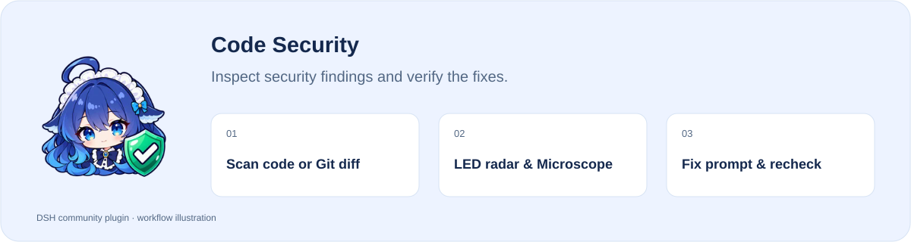
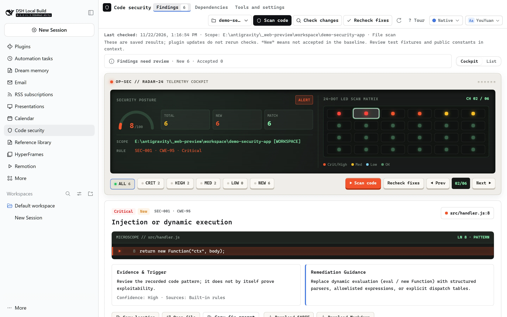

[简体中文](README.md) · **English**

# Code Security

> **Inspect security findings in your codebase, examine fault slices, and verify fixes end to end.**

Code security workbench for DeepSeek Harness (`>=0.2.2-rc.3`): opens in the **OP-SEC Hardware Instrument Cockpit** (ceramic deck, OLED posture display, 24-dot LED Scan Matrix & Code Microscope, plus classic List view), across 13 styles × 8 fonts.

[](https://www.npmjs.com/package/dsh-code-security) [](https://www.npmjs.com/package/dsh-code-security) [](https://www.npmjs.com/package/dsh-code-security)

**[Features](#features) · [Install](#install) · [Workflow](#start-using-it) · [Full guide](https://github.com/STARDUSTLC666/dsh-code-security/blob/master/docs/REFERENCE.en.md)**

<picture>
  <source media="(prefers-color-scheme: dark) and (max-width: 640px)" srcset="https://raw.githubusercontent.com/STARDUSTLC666/dsh-code-security/master/docs/assets/intro/workflow-en-mobile-dark.svg">
  <source media="(max-width: 640px)" srcset="https://raw.githubusercontent.com/STARDUSTLC666/dsh-code-security/master/docs/assets/intro/workflow-en-mobile-light.svg">
  <source media="(prefers-color-scheme: dark)" srcset="https://raw.githubusercontent.com/STARDUSTLC666/dsh-code-security/master/docs/assets/intro/workflow-en-dark.svg">
  
</picture>

## Features

| Pillar | Capabilities |
| :--- | :--- |
| **OP-SEC Instrument Cockpit** | Recessed OLED posture gauge, interactive 24-dot severity LED Matrix, 3D mechanical filter keycaps & Code Microscope with CWE remediation guidance; 1-click classic **List** toggle |
| **Local SAST & Git Diff Review** | Built-in static rules work out of the box across files, directories, and Git diffs; optional Betterleaks and Semgrep CE integration |
| **Dependency Audit & Reports** | Audit dependency manifests offline or against OSV, and export clean Markdown or SARIF reports |
| **Fix Recheck & Synced UI** | 1-click fix prompt copy to chat, **Recheck fixes** verification loop, `? Tour` walkthroughs & 13 synced styles × 8 fonts |

<details>
<summary>See a workbench example (OP-SEC Instrument Cockpit)</summary>



Captured from the live DeepSeek Harness workbench using demo data.

</details>

## Install

Open **Plugins** in the DSH desktop app and install `dsh-code-security`, or use the CLI:

```bash
dsh plugin --profile desktop add dsh-code-security
```

For the web profile, replace `desktop` with `web` and restart DSH. Requires DSH `>=0.2.2-rc.3`.

## Start using it

1. **Scan code or Git diff**: Open **Code security** from the sidebar, pick a workspace, and press **▶ Scan code** or **Check changes**.
2. **Pinpoint on the LED Matrix**: Read overall posture on the OLED display, click severity dots or filter keycaps, and inspect `file:line` slices and CWE guidance in the **Code Microscope** (toggle **Cockpit / List** anytime).
3. **Patch in chat**: Click **Copy fix prompt** and paste into your project chat so the assistant resolves the root cause in context.
4. **Recheck & export**: Press **Recheck fixes** on the same scope to confirm closure with zero regressions, then export SARIF or Markdown reports.

### Ready-to-copy prompts

- **Git diff audit**: `Review current Git changes for security issues with triggers, file locations, and redacted evidence`
- **Project scan**: `Check this project for security issues and prioritize high-risk findings`
- **Fix & verify**: `Fix high-risk findings from the latest security check, then recheck the same scope to confirm closure`

## Before you start

- Betterleaks, Semgrep CE, and OSV are optional additions; a clean scan does not guarantee the absence of vulnerabilities.
- Full configuration, tools, and troubleshooting: [full reference](https://github.com/STARDUSTLC666/dsh-code-security/blob/master/docs/REFERENCE.en.md).

## Plugin updates

Check updates at the bottom of the workbench or native plugin details. Automatic checks are on by default; **automatic installation is off**. Suite-managed components update with their bundle.

## Documentation & feedback

- [Full usage, configuration and limits](https://github.com/STARDUSTLC666/dsh-code-security/blob/master/docs/REFERENCE.en.md) · [Release notes](https://github.com/STARDUSTLC666/dsh-code-security/blob/master/CHANGELOG.md) · [Validation history](https://github.com/STARDUSTLC666/dsh-code-security/blob/master/docs/VALIDATION.md)
- Stars, [Issues](https://github.com/STARDUSTLC666/dsh-code-security/issues), and [PRs](https://github.com/STARDUSTLC666/dsh-code-security/pulls) are welcome (strip credentials first).

## License

[MIT](https://github.com/STARDUSTLC666/dsh-code-security/blob/master/LICENSE)

<a id="what-it-does"></a>
<a id="requirements-and-configuration"></a>
