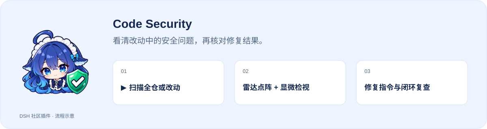

**简体中文** · [English](README.en.md)

# Code Security

**看清改动中的安全问题，再核对修复结果。**

DeepSeek Harness（`>=0.2.2-rc.3`）代码安全工作台：支持本地静态扫描、Git 改动审查、依赖漏洞检查与修复复核，可选接入 Betterleaks / Semgrep CE / OSV-Scanner。工作台内置 5 套明亮可切换界面风格（原生清透 / 米白纸感 / Claude 暖书卷 / 8-Bit 像素 / 晴空薄荷，深色模式自动柔和适配）与按钮微交互动效，跨插件实时同步。

[](https://www.npmjs.com/package/dsh-code-security) [](https://www.npmjs.com/package/dsh-code-security) [](https://www.npmjs.com/package/dsh-code-security)

**[安装使用](#安装) · [使用流程](#开始使用) · [完整说明](https://github.com/STARDUSTLC666/dsh-code-security/blob/master/docs/REFERENCE.zh.md)**

<picture>
  <source media="(prefers-color-scheme: dark) and (max-width: 640px)" srcset="https://raw.githubusercontent.com/STARDUSTLC666/dsh-code-security/master/docs/assets/intro/workflow-zh-mobile-dark.svg">
  <source media="(max-width: 640px)" srcset="https://raw.githubusercontent.com/STARDUSTLC666/dsh-code-security/master/docs/assets/intro/workflow-zh-mobile-light.svg">
  <source media="(prefers-color-scheme: dark)" srcset="https://raw.githubusercontent.com/STARDUSTLC666/dsh-code-security/master/docs/assets/intro/workflow-zh-dark.svg">
  
</picture>

## 功能

- 检查文件、目录或 Git 改动，并对依赖清单执行离线清单或 OSV 漏洞检查。
- 在适配 DeepSeek Harness `>=0.2.2-rc.3` 的 Workbench UI v2 工作台中查看位置、规则、覆盖范围和脱敏证据。
- 顶部支持 5 套工作台风格一键切换（原生清透 / 米白纸感 / Claude 暖书卷 / 8-Bit 像素 / 晴空薄荷），配有微交互动效与减少动态效果适配。
- 重新检查同一范围核对修复，按需导出 Markdown 或 SARIF 报告。

<details>
<summary>查看实际示例</summary>


图片来自验证环境的真实工作台界面，使用示例数据。

</details>

## 安装

在 DSH 桌面版「插件」面板安装 `dsh-code-security`。已配置命令行时也可使用：

```bash
dsh plugin --profile desktop add dsh-code-security
```

网页版把 `desktop` 改为 `web`；安装后重启对应的 DSH。宿主要求以包声明 `>=0.2.2-rc.3` 为准。

## 开始使用

推荐按 **「扫改动 → 看证据链 → 让助手修漏洞 → 复测归档」** 4 步巡检流使用：

1. **扫改动 / 扫全仓**：在目标仓库对话里发起首次检查，或在「代码安全」工作台空态里直接点 **「检查代码」/「检查改动」**（内置规则开箱即用，无需额外安装）。
2. **看证据链**：在「检查结果」核对文件行号、数据流或模式依据与脱敏代码片段，结合上下文区分真实风险与测试夹具、预期公开常量。
3. **让助手修漏洞**：在工作台或单条问题详情里点 **「复制修复指令」** 粘贴到项目聊天，让助手结合代码上下文改为参数化查询、安全命令数组或移除硬编码凭据。
4. **复测归档**：修完后点 **「复查修复」** 对同一范围重验问题是否关闭、是否引入新风险，按需下载 Markdown 或 SARIF 报告留存。

常用对话指令（工作台内支持一键复制）：

- `审查当前 Git 改动的安全问题，给出触发条件、文件位置和脱敏证据`
- `检查这个项目的安全问题并按高风险优先汇总`
- `根据当前安全检查结果逐项修复高风险问题，修完后对同一范围复查确认关闭`

## 开始前要知道

Betterleaks、Semgrep CE 与 OSV 是可选增强；扫描报告不能证明项目没有漏洞。

配置、完整工具与排错见[详细使用说明](https://github.com/STARDUSTLC666/dsh-code-security/blob/master/docs/REFERENCE.zh.md)。

## 插件更新

在工作台或原生插件详情页底部检查更新。默认自动检查，**默认不自动安装**；是否安装、何时重启由你决定。Suite 管理的组件随整包更新。[查看更新规则](https://github.com/STARDUSTLC666/dsh-code-security/blob/master/docs/REFERENCE.zh.md)。

## 文档

- [详细使用、配置与边界](https://github.com/STARDUSTLC666/dsh-code-security/blob/master/docs/REFERENCE.zh.md)
- [更新记录](https://github.com/STARDUSTLC666/dsh-code-security/blob/master/CHANGELOG.md)
- [验证范围与历史](https://github.com/STARDUSTLC666/dsh-code-security/blob/master/docs/VALIDATION.md)

## 反馈与贡献

如果插件帮到了你，欢迎 Star，让更多人发现它。问题和建议请提交 [Issues](https://github.com/STARDUSTLC666/dsh-code-security/issues)，也欢迎代码与文档 [PR](https://github.com/STARDUSTLC666/dsh-code-security/pulls)。反馈时附上版本与复现步骤，并移除凭据。

## License

[MIT](https://github.com/STARDUSTLC666/dsh-code-security/blob/master/LICENSE)

<a id="依赖与配置"></a>
