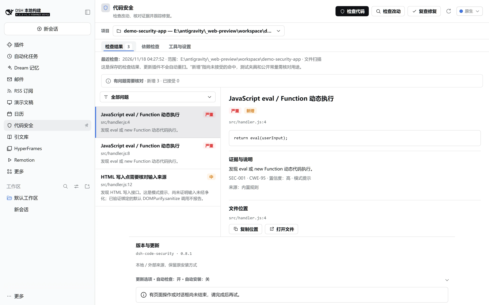

**简体中文** · [English](README.en.md)

# Code Security

> **看清改动中的安全问题，定位证据切片并闭环复核修复结果。**

DeepSeek Harness（`>=0.2.2-rc.3`）代码安全工作台：默认 **OP-SEC 精密雷达态势仪**（暖陶瓷机身 + OLED 态势屏 + 24 点 LED 矩阵 + 代码显微舱，1 键切回经典列表），内置 13 套风格 × 8 套双层字体。

[](https://www.npmjs.com/package/dsh-code-security) [](https://www.npmjs.com/package/dsh-code-security) [](https://www.npmjs.com/package/dsh-code-security)

**[核心能力](#核心能力) · [安装](#安装) · [快速上手](#开始使用) · [完整说明](https://github.com/STARDUSTLC666/dsh-code-security/blob/master/docs/REFERENCE.zh.md)**

<picture>
  <source media="(prefers-color-scheme: dark) and (max-width: 640px)" srcset="https://raw.githubusercontent.com/STARDUSTLC666/dsh-code-security/master/docs/assets/intro/workflow-zh-mobile-dark.svg">
  <source media="(max-width: 640px)" srcset="https://raw.githubusercontent.com/STARDUSTLC666/dsh-code-security/master/docs/assets/intro/workflow-zh-mobile-light.svg">
  <source media="(prefers-color-scheme: dark)" srcset="https://raw.githubusercontent.com/STARDUSTLC666/dsh-code-security/master/docs/assets/intro/workflow-zh-dark.svg">
  
</picture>

## 核心能力

| 模块 | 核心特性 |
| :--- | :--- |
| **OP-SEC 精密雷达态势仪** | 左侧 OLED 态势屏展示安全分与遥测，右侧 24 点可点击 LED 矩阵按严重度点亮，下方代码显微舱直显故障代码与 CWE 修复建议；1 键切回经典「列表」 |
| **本地静态扫描与改动审查** | 内置 40+ 安全规则开箱即用，支持单文件、全仓库与 Git 改动增量扫描，可选接入 Betterleaks / Semgrep CE |
| **依赖审计与报告归档** | 支持依赖清单离线检查或 OSV 漏洞查询，一键导出 Markdown 或 SARIF 报告留存 |
| **修复复核闭环与外观** | 显微舱一键复制修复指令交由助手整改，再点「复查修复」确认清零无回归；内置 `? 引导` 与 13 套风格 × 8 套字体 |

<details>
<summary>查看工作台实景截图（OP-SEC 精密雷达态势仪）</summary>



图片来自验证环境的真实工作台界面，使用示例数据。

</details>

## 安装

在 DSH 桌面版「插件」面板安装 `dsh-code-security`，或使用命令行：

```bash
dsh plugin --profile desktop add dsh-code-security
```

网页版将 `desktop` 改为 `web`，安装后重启 DSH。宿主要求：`>=0.2.2-rc.3`。

## 开始使用

1. **发起扫描**：从左侧栏打开「代码安全」选择工作区，点朱红键 **「▶ 检查代码」** 或 **「检查改动」**（内置规则零依赖开箱即用）。
2. **雷达定位与显微检视**：在 OLED 屏查看态势分，点击 **24 点 LED 雷达矩阵** 或按严重度机械键筛选，在下方显微舱核对 `文件:行`、代码切片与 CWE 建议。
3. **一键交付助手修复**：点击「复制修复指令」粘贴到项目聊天，让助手结合上下文完成安全改造。
4. **复查修复与归档**：整改后点 **「复查修复」** 重验同一范围，确认问题关闭且无新增风险，按需导出 SARIF 或 Markdown 报告。

### 常用对话示例

- **审查当前改动**：`审查当前 Git 改动中的安全问题，列出触发条件、文件位置与脱敏证据`
- **全仓高危排查**：`检查这个项目的代码安全问题，优先按高风险排序并给出修复建议`
- **修复并复验**：`修复最近一次安全检查中的高危问题，然后对同一范围复查修复是否清零`

## 开始前要知道

- Betterleaks、Semgrep CE 与 OSV 为可选增强项；静态扫描不能单独证明代码绝对无漏洞。
- 详细配置、工具与排错见 [完整说明](https://github.com/STARDUSTLC666/dsh-code-security/blob/master/docs/REFERENCE.zh.md)。

## 插件更新

在工作台或原生插件详情页底部检查更新。默认自动检查，**默认不自动安装**；Suite 管理的组件随整包更新。

## 文档与反馈

- [完整使用、配置与边界](https://github.com/STARDUSTLC666/dsh-code-security/blob/master/docs/REFERENCE.zh.md) · [更新记录](https://github.com/STARDUSTLC666/dsh-code-security/blob/master/CHANGELOG.md) · [验证历史](https://github.com/STARDUSTLC666/dsh-code-security/blob/master/docs/VALIDATION.md)
- 欢迎 Star、提交 [Issues](https://github.com/STARDUSTLC666/dsh-code-security/issues) 与 [PR](https://github.com/STARDUSTLC666/dsh-code-security/pulls)（反馈请附版本与复现步骤，并移除凭据）。

## License

[MIT](https://github.com/STARDUSTLC666/dsh-code-security/blob/master/LICENSE)

<a id="依赖与配置"></a>
